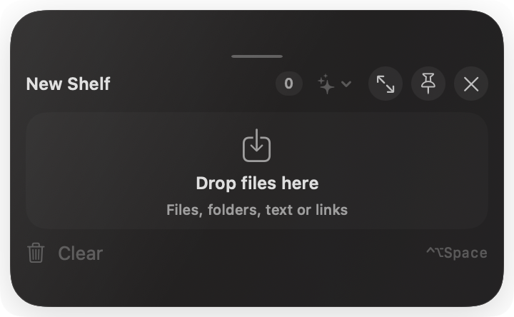

<div align="center">

# Stash

### Your files, right where you need them.

Stash is a native macOS floating shelf for collecting files, folders, links, and text while you work — then moving or processing them without losing your place.


</div>


<p align="center"><sub>One compact shelf for the files you are actively working with.</sub></p>

## Why Stash?

Your desktop and Downloads folder are not a workflow. Stash gives you small, independent shelves that stay handy while you collect files, prepare an attachment, organize a batch, or run a quick file action.

## Drop it. Keep it. Do more.

### Drop it.

Drag files, folders, links, or text onto a floating shelf from Finder or another supported app.



### Keep it.

Open multiple shelves, resize them freely, and pin the ones that should return after a restart.


### Do more.

Select files and use Smart Actions without interrupting the work in front of you.


## Built for the way macOS works

| | |
| --- | --- |
| **Floating glass shelves** | Compact, resizable shelves that stay out of your way until you need them. |
| **Native drag-and-drop** | Bring items in from Finder and drag them back out to Finder, an attachment field, or another supported destination. |
| **Multiple focused shelves** | Keep separate groups for a task, project, or handoff. |
| **Quick visual recognition** | Native image thumbnails and clean filename truncation make items easier to scan. |
| **Smart Actions** | Convert or resize images, create ZIPs, batch rename, and merge PDFs. |
| **Local-first** | Your files stay on your Mac. Stash has no network features, analytics, or telemetry. |

## Getting started

### Install from GitHub Releases

Verified public versions will be listed on the [Stash Releases page](https://github.com/harshitcodes1308/stash/releases). When a notarized DMG is available, download `Stash-x.y.z.dmg`, open it, and drag `Stash.app` to the `Applications` shortcut inside the window.

> **Current status:** The `v0.1.1` DMG packaging is prepared, but a verified public binary is not available yet. It must be Developer ID signed and notarized before this becomes the recommended installation path.

### Build from source — available now

Stash is currently available as a source-build beta for **macOS 13 or later**. From a checkout of this repository:

```zsh
xcode-select --install # only if Xcode Command Line Tools are not installed
./Packaging/package-release.sh
open -n build/Stash.app
```

Look for Stash in the menu bar, or press `Control` + `Option` + `Space` to open a shelf.

The local packages, `build/Stash-0.1.1.dmg` and `build/Stash-0.1.1.zip`, are ad-hoc signed for development and testing; they are **not notarized**. A Developer ID-signed, notarized release will be listed on GitHub only after it exists.

## Smart Actions

| Action | Result |
| --- | --- |
| **Convert Images** | Creates a new image in your chosen format; the original stays unchanged. |
| **Resize Images** | Produces resized copies without altering source images. |
| **Create ZIP** | Archives only the items you select, using safe relative paths. |
| **Batch Rename** | Previews a collision-safe rename plan and asks for confirmation before changing originals. |
| **Merge PDFs** | Combines selected, readable PDFs in the order you choose. |

Generated files are retained locally in `~/Library/Application Support/Stash/Generated Outputs` so they remain usable after relaunching.

## Privacy and safety

- Stash keeps file references; it does not silently copy files into a shelf.
- Image, ZIP, and PDF actions create new output files rather than overwrite originals.
- Batch Rename is intentionally different: it renames selected originals only after you review and confirm the plan.
- Missing file references are shown as unavailable instead of silently removed.

## Building from source

Run the project’s complete automated checks before packaging a build:

```zsh
./Tools/run-regressions.sh
./Packaging/package-release.sh
codesign --verify --deep --strict --verbose=2 build/Stash.app
```

See the [release guide](docs/release.md) for packaging, signing, and manual QA requirements.

## Contributing

Contributions are welcome. Please preserve the local-first model, avoid changing file sources unexpectedly, and run the checks above before opening a change. The project architecture is described in [docs/architecture.md](docs/architecture.md).

## License and release status

Stash is licensed under the [MIT License](LICENSE).

Version 0.1.1 is a source-build beta. It is ad-hoc signed, not notarized, and has no public binary release yet. See the [manual QA checklist](docs/manual-qa.md) and [release guide](docs/release.md) for the remaining release work.
