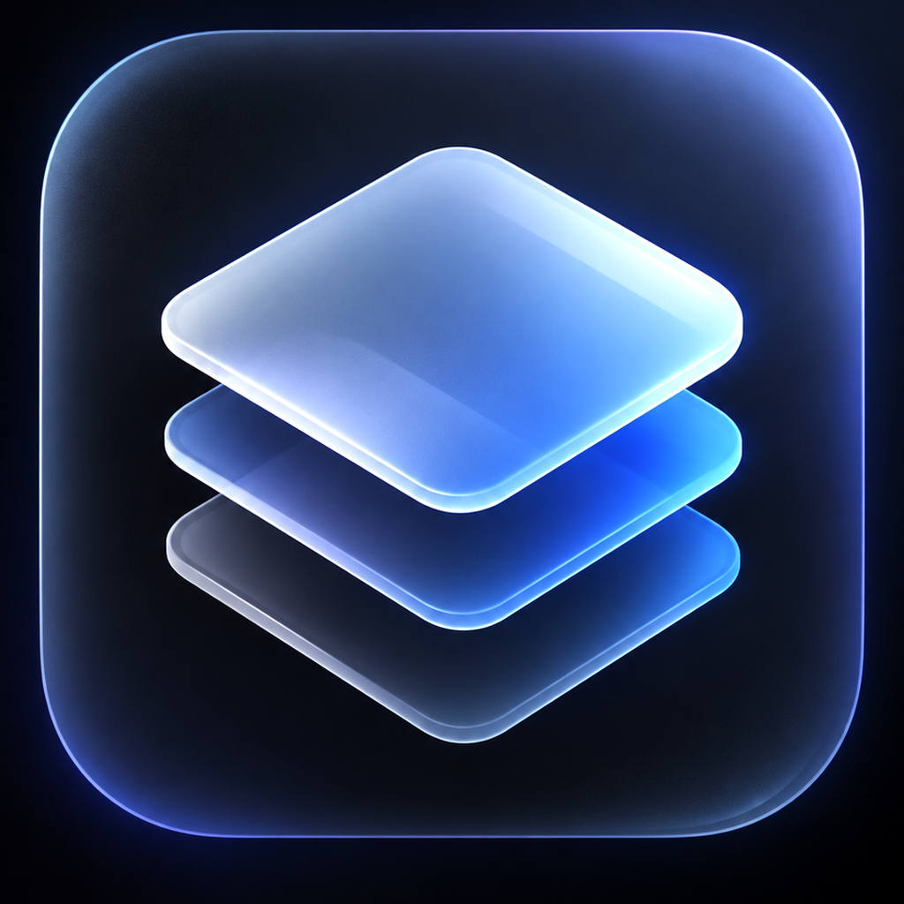
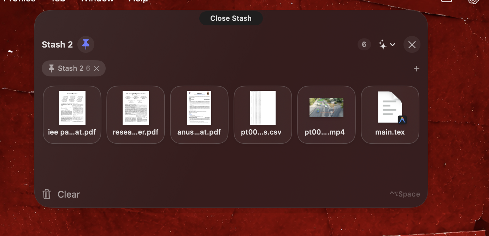
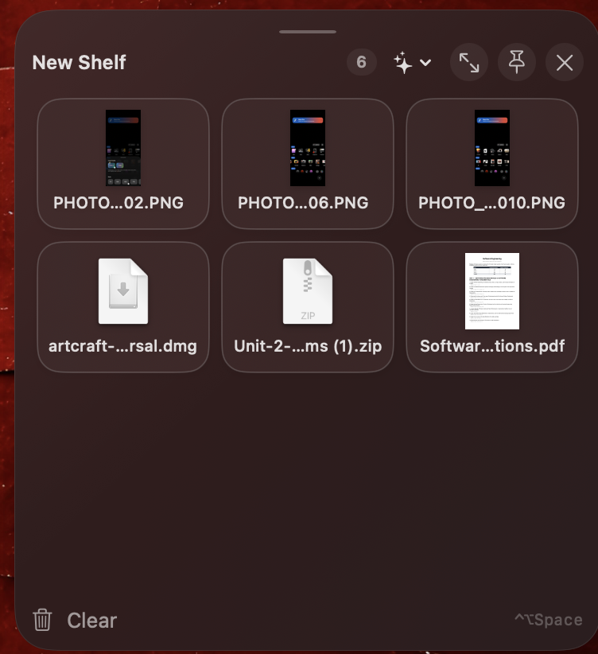
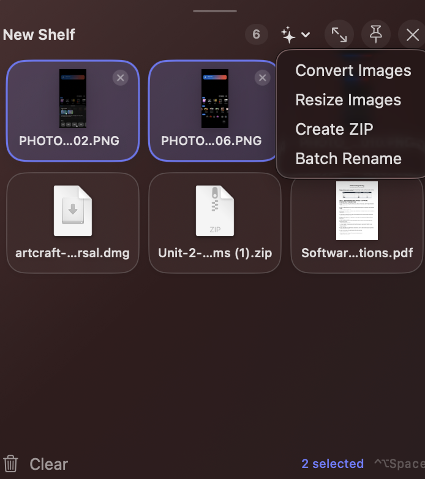

<div align="center">



# Stash

**Your files, right where you need them.**

Drag files toward your MacBook's notch and Stash opens a floating shelf to hold them. Keep files within reach, move them between apps, and handle common file tasks without losing your place.


[](LICENSE)

**[Download Stash for macOS](https://github.com/harshitcodes1308/stash/releases/download/v0.2.0/Stash-0.2.0.dmg)** · [SHA-256 checksum](https://github.com/harshitcodes1308/stash/releases/download/v0.2.0/Stash-0.2.0.dmg.sha256)

<sub>Public beta · ad-hoc signed · not notarized. macOS may block the first launch.</sub>

</div>

<div align="center">
<br>

<br><sub>Real Stash v0.2.0 capture. The notch silhouette above the capture is an illustration.</sub>
</div>

## Meet your new drop zone.

| 1. Drag toward the notch | 2. Drop into Stash | 3. Keep working |
| --- | --- | --- |
| Drag files from Finder toward the top-center drop target. | The shelf opens to receive them, then folds away after the drop. | Click **Open Stash** to keep it open, switch tabs, drag files out, or use Smart Actions. |

Notch Mode is on by default and can be changed from **Stash Settings** in the menu bar. On a Mac without a physical notch, Stash uses a top-center drop target.

## A shelf when you need one.

| | |
| --- | --- |
| **Notch workspace** | A compact drop target expands around the top of the screen. Keep separate tabs and pin the ones you want after restart. |
| **Floating shelves** | Create, move, resize, and pin regular shelves for different tasks. |
| **Drag and drop** | Bring files in from Finder and drag them out to Finder or another compatible app. |
| **Visual file tiles** | Image thumbnails and compact filenames help you find the right item. |
| **Smart Actions** | Convert or resize images, create ZIPs, batch rename, and merge PDFs. |
| **Local-first** | File processing happens on your Mac. Stash has no telemetry or account requirement. |

<div align="center">
<br>
<sub>Floating shelf capture from v0.1.1; the notch workspace above shows v0.2.0.</sub>
</div>

## Get started

1. [Download `Stash-0.2.0.dmg`](https://github.com/harshitcodes1308/stash/releases/download/v0.2.0/Stash-0.2.0.dmg).
2. Open the DMG and drag **Stash.app** onto the **Applications** shortcut.
3. Open Stash from Applications and find its icon in the menu bar.
4. Drag a file toward the notch, or press **Control + Option + Space** to open a shelf.

This beta is **not Developer ID signed or notarized**. macOS Gatekeeper may prevent it from opening normally. See the [release page](https://github.com/harshitcodes1308/stash/releases/tag/v0.2.0) for the current distribution status. A notarized build requires an Apple Developer ID and an approved notarization submission.

If macOS blocks Stash, first verify the DMG against its [SHA-256 checksum](https://github.com/harshitcodes1308/stash/releases/download/v0.2.0/Stash-0.2.0.dmg.sha256). If you trust this beta, try opening it once, then use **System Settings → Privacy & Security → Open Anyway** for Stash. This creates an exception for this app only; [Apple explains the steps and risks](https://support.apple.com/en-us/102445).

### Everyday use

- Use **Open Stash** at the top center to keep the notch shelf open; click again to close it.
- Use the **+** control in the notch workspace or **New Stash** in the menu bar to create another tab.
- Select files before opening **Smart Actions**. Drag a file tile out when you need it elsewhere.
- Use the shelf pin control to retain a tab for the next launch. Regular floating shelves also support resizing.
- Choose **Quit Stash** from the menu bar when finished.



## Smart Actions

| Action | What it does | Original files |
| --- | --- | --- |
| Convert Images | Creates copies in another supported format | Unchanged |
| Resize Images | Creates resized copies | Unchanged |
| Create ZIP | Archives the selected items | Unchanged |
| Batch Rename | Previews a rename plan and asks for confirmation | Renamed after confirmation |
| Merge PDFs | Combines selected PDFs in your chosen order | Unchanged |

Generated files are stored locally in `~/Library/Application Support/Stash/Generated Outputs` so they remain available after relaunching.

## Privacy and safety

Stash keeps file references in shelves rather than silently copying every source file. Smart Actions process files locally. Image, ZIP, and PDF actions create new output; Batch Rename changes originals only after you confirm the preview. Missing references appear as unavailable.

## Build from source

Stash supports macOS 13 or later. Install Xcode Command Line Tools if needed, then run from a checkout:

```zsh
xcode-select --install # only if the tools are not already installed
./Tools/run-regressions.sh
./Packaging/package-release.sh
open -n build/Stash.app
```

The package script creates `build/Stash-0.2.0.dmg` and its SHA-256 checksum file. See the [release guide](docs/release.md) for signing and verification details.

## Contributing

Contributions are welcome. Please run the regression suite and keep file handling local. Start with the [architecture notes](docs/architecture.md) and [manual QA checklist](docs/manual-qa.md).

## License and release status

Stash is licensed under the [MIT License](LICENSE). v0.2.0 is a public beta with an ad-hoc signature and no notarization; the [release notes](docs/release-notes-v0.2.0.md) describe what has been verified.
